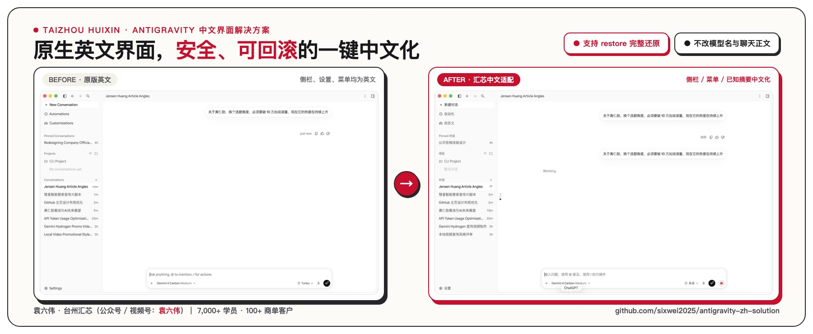
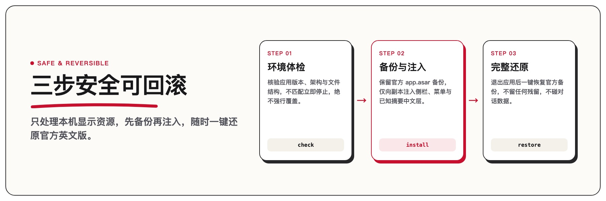

<div align="center">



# 汇芯·Antigravity 中文界面解决方案

### 给 macOS Antigravity 加上一层自然、可回滚的中文界面适配


> 袁六伟 · 台州汇芯创始人｜得到 / 华为分享老师｜多家企业 AI 落地顾问
>
> 累计带出实战学员 7,000+，服务企业商单客户 100+（覆盖近 20 个行业）。

[痛点与边界](#痛点与边界) · [新手安装](#新手安装把链接发给-ai) · [快速开始](#快速开始) · [工作原理](#工作原理) · [常见问题](#常见问题)

</div>

## 新手安装：把链接发给 AI

如果你不熟悉终端，打开 Codex、WorkBuddy，或其他支持读取本地文件的 AI，把下面这句话发给它：

```text
帮我安装这个仓库里的 Antigravity 中文界面解决方案：
https://github.com/sixwei2025/antigravity-zh-solution
```

这是 macOS 桌面应用的本地适配工具，不是一个已经自动安装到所有智能体里的 Skill。安装后可以继续问 AI：“带我做一次检查和还原演练”。

## 痛点与边界

| 使用原版 | 使用汇芯中文适配 |
| --- | --- |
| 侧栏、设置、权限选项大量英文 | 常用界面改为自然中文 |
| 对话列表只有英文主题摘要 | 已知主题摘要显示中文，便于回看 |
| macOS 顶部菜单仍是英文 | 文件、编辑、视图、窗口等菜单中文化 |
| 担心改坏应用无法恢复 | 安装前备份，支持 `restore` 完整还原 |
| 模型名、代码和正文容易被误翻 | 只处理界面文字，不翻译模型名、代码和聊天正文 |

## 快速开始

在 Antigravity 完全退出后，在本仓库目录运行：

```bash
python3 antigravity_zh_switcher.py check
python3 antigravity_zh_switcher.py install
# 开启升级自动保持汉化（推荐：以后 Antigravity 升级后退出重启即可 15 秒内自动恢复中文）
python3 antigravity_zh_switcher.py guard-enable
```

> **macOS 一次性授权提示**：首次运行 `guard-enable` 会自动生成静默后台应用壳 `~/Library/Application Support/huixin-antigravity-zh/HuixinZhGuard.app`。请在 **系统设置 → 隐私与安全性 → App 管理** 中添加并打开 `HuixinZhGuard.app` 的开关，之后每次官方升级都会在后台自动静默恢复汉化，无需再次授权。

查看守护状态或关闭自动守护：

```bash
python3 antigravity_zh_switcher.py guard-status
python3 antigravity_zh_switcher.py guard-disable
```

恢复官方英文版：

```bash
python3 antigravity_zh_switcher.py restore
```

第一次使用建议只运行 `check`。工具当前针对 Antigravity `2.33.0`、Apple Silicon、含 `app.asar.unpacked` 的 macOS 结构完成验证；如果版本结构不匹配，会停止而不是强行覆盖。`--force` 只用于已经确认兼容的版本。

## 工作原理



整个过程只处理本机应用的显示资源：先检查版本与文件结构，再保留官方 `app.asar` 备份，向副本注入界面翻译层，最后由 Electron 加载解包目录。还原时删除适配副本并恢复备份，不改动账号、对话数据、模型能力、网络设置或官方服务。

### 三步闭环

1. 检查：确认应用版本、架构和入口文件。
2. 安装：备份官方文件，注入翻译层，保留可回滚副本。
3. 还原：退出应用后执行 `restore`，回到官方英文版。

## 已覆盖的界面

- 侧栏：新建对话、自动化、自定义、项目、对话、设置。
- 对话列表：已知主题摘要，例如“公司官网改版设计”“Gemini Hydrogen 宣传视频制作”“本地视频宣传风格评审”。
- 对话区域：对话记录、你说、智能体说、复制、撤销到此处、运行耗时等。
- 权限选择：请求审阅、默认、自动、高速及对应说明。
- 顶部菜单：文件、编辑、视图、窗口。

对话摘要采用安全的已知标题映射，不会把聊天正文、代码、文件内容和用户输入当成界面文字批量翻译。Antigravity 官方升级后，个别新增词语可能仍需补充适配。

## 常见问题

### 安装后还是英文怎么办？

先完全退出 Antigravity，再运行 `check`。如果刚升级过版本，先不要删除备份，也不要重复覆盖；把 `check` 的结果交给 AI 判断是否需要更新适配。

### 界面异常怎么恢复？

完全退出 Antigravity 后运行：

```bash
python3 antigravity_zh_switcher.py restore
```

### 会不会翻译模型输出？

不会。工具只处理应用自己的界面文字；模型名称、聊天正文、代码和文件内容保持原样。

## 仓库目录与诚实边界

```text
antigravity-zh-solution/
├── antigravity_zh_switcher.py      # 检查、安装、还原
├── assets/showcase/hero-banner-v2.jpg # 汉化前后真实界面对比
├── assets/showcase/pipeline-architecture-v2.jpg
├── CHANGELOG.md
├── LICENSE
└── README.md
```

本项目不是 Google 官方产品，也不代表 Google。它是针对 macOS Antigravity 桌面端结构的本地界面适配；不同版本的应用结构可能变化，安装前请保留工作内容与官方备份。

## 汇芯开源矩阵

更多由袁六伟 · 台州汇芯维护的开源工具：

| 方向 | 项目 |
| --- | --- |
| 视频与地图 | [3d-map-video-skill](https://github.com/sixwei2025/3d-map-video-skill)、[dark-infographic-video-skill](https://github.com/sixwei2025/dark-infographic-video-skill)、[talking-head-video-skill](https://github.com/sixwei2025/talking-head-video-skill)、[trending-news-video-skill](https://github.com/sixwei2025/trending-news-video-skill) |
| 内容与公众号 | [workbuddy-wechat-autopilot](https://github.com/sixwei2025/workbuddy-wechat-autopilot)、[gzh-million-layout-skill](https://github.com/sixwei2025/gzh-million-layout-skill)、[wechat-cover-skill](https://github.com/sixwei2025/wechat-cover-skill)、[ai-tool-review-wechat-skill](https://github.com/sixwei2025/ai-tool-review-wechat-skill) |
| AI 与桌面工具 | [yuanliuwei-ai-skills](https://github.com/sixwei2025/yuanliuwei-ai-skills)、[huixin-skills-manager](https://github.com/sixwei2025/huixin-skills-manager)、[huixin-token-manager](https://github.com/sixwei2025/huixin-token-manager)、[local-video-hub](https://github.com/sixwei2025/local-video-hub) |
| 自动化与创作 | [auto-tutorial-skill](https://github.com/sixwei2025/auto-tutorial-skill)、[psych-kepu-video-skill](https://github.com/sixwei2025/psych-kepu-video-skill)、[sunrise-tracker](https://github.com/sixwei2025/sunrise-tracker)、[book-skill](https://github.com/sixwei2025/book-skill) |

## 品牌与许可

袁六伟 · 台州汇芯（公众号/视频号：袁六伟）。本项目采用 MIT License；基于公开社区项目获得版本线索与启发的部分，均保留原作者与许可边界，不把他人成果说成完全原创。
